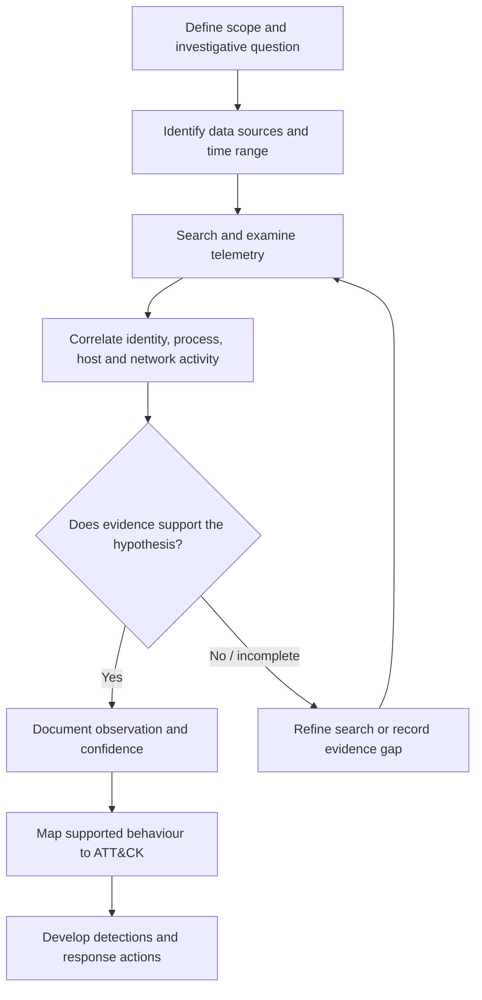

# Enterprise Intrusion Investigation Playbook
### SOC Analysis · Threat Hunting · Digital Forensics & Incident Response

  <strong>SPLUNK · WINDOWS TELEMETRY · DETECTION ENGINEERING · MITRE ATT&CK</strong>

---

## Project Overview

This repository is a practical, evidence-led playbook for investigating suspicious activity in a Windows-based enterprise environment.

It documents a repeatable SOC/DFIR workflow: scope an investigation, identify relevant telemetry, formulate hypotheses, search and correlate events, assess confidence, map supported behaviour to MITRE ATT&CK, and turn findings into detection and response actions.

The repository separates reusable methodology from a clearly labelled **simulated case study**. The simulated case uses fictional assets and synthetic evidence to demonstrate how an analyst can document findings, timelines, limitations and detection opportunities. It is not a report of a real intrusion or a completed hands-on investigation.

## Project sections

| Section | Purpose |
|---|---|
| [Case overview](01-Case-Overview/case-overview.md) | Scope, assumptions and evidence standard |
| [Investigation playbooks](02-Investigation/) | Investigative questions and analysis methods by activity area |
| [ATT&CK mapping](03-MITRE-ATTACK/attack-mapping.md) | Candidate technique mapping and confidence rules |
| [Splunk hunting](04-Detection-Engineering/splunk-hunting.md) | Reusable SPL hunt templates |
| [Detection specifications](04-Detection-Engineering/detection-rules.md) | Detection logic, tuning and validation |
| [Windows artefacts](05-Digital-Forensics/windows-artifacts.md) | Forensic value and limitations of common artefacts |
| [Incident response](06-Incident-Response/response-recommendations.md) | Containment through recovery |
| [Evidence catalogue](07-Evidence/evidence-catalogue.md) | Evidence register and handling standard |
| [Timeline](07-Evidence/intrusion-timeline.md) | Timestamp normalisation and event sequencing |
| [Simulated intrusion investigation](08-Simulated-Investigation/) | Fictional enterprise case study with findings, timeline, evidence register, ATT&CK mapping and detection analysis |

## What this project demonstrates

- Investigative question development and hypothesis testing.
- Windows event-log and Sysmon analysis.
- Splunk SPL search construction and event correlation.
- Process, identity, registry, file and network telemetry analysis.
- Evidence handling, timeline construction and confidence assessment.
- MITRE ATT&CK mapping with explicit evidence requirements.
- Detection specification, tuning and validation.
- Incident containment, eradication, recovery and lessons learned.

## Investigation workflow

## Tools and technologies

| Technology | Use |
|---|---|
| Splunk Enterprise | Search, correlation and threat hunting |
| Windows Event Logs | Authentication, process and system activity |
| Sysmon | Process, network, file and registry telemetry |
| PowerShell logging | Script-block and operational visibility |
| CyberChef | Safe examination of encoded or transformed data |
| MITRE ATT&CK | Behaviour classification and defensive coverage |

## Evidence and validation

The repository distinguishes between:

- **Observed:** directly present in a reviewed data source.
- **Correlated:** supported by multiple related observations.
- **Inferred:** a plausible interpretation that is not directly proven.
- **Unknown:** information the available telemetry cannot establish.

No search is described as tested unless it has been run against a known dataset and its results reviewed. Example SPL assumes common Windows or Sysmon field names; sourcetype, field extraction, CIM mapping and time range must be confirmed in each environment.

Screenshots will be added only when they come from the author's own analysis, support a documented point, and are suitable for public release. Conceptual diagrams and synthetic case evidence are labelled as such.

## Scope and limitations

This is an educational defensive-security playbook. It is not a real-world incident report, attribution assessment, or claim that the example searches detect every variant of a behaviour.

A command line alone does not prove intent or successful execution. A file copy does not prove external exfiltration. A configuration change does not prove a successful network session. Conclusions require context and corroboration.

**Project status:** reusable methodology plus a clearly labelled synthetic case study. Dataset-backed validation and original evidence examples remain future work.
