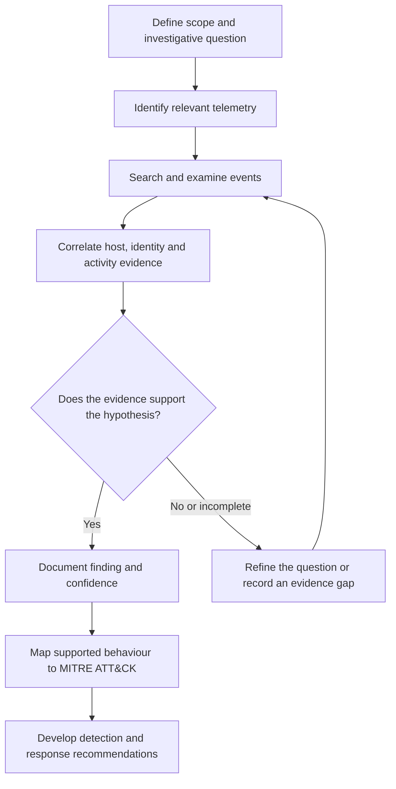

# Enterprise Intrusion Investigation
### SOC Analysis · Threat Hunting · Digital Forensics & Incident Response

  <strong>SPLUNK · WINDOWS FORENSICS · DETECTION ENGINEERING · MITRE ATT&CK</strong>

---

## Project Overview

This repository presents a defensive investigation of suspicious activity across a simulated enterprise Windows environment.

The work focuses on reconstructing an intrusion from endpoint and security telemetry, assessing the significance of observed behaviour, and translating investigative findings into practical detection and incident-response considerations.

The investigation examines activity across identity and account management, native Windows utilities, Active Directory data, web-server persistence, credential-access behaviour, authentication events, inter-host movement, sensitive-file collection, network proxy configuration and log tampering.

The emphasis is on **evidence-led analysis**: identifying what the available artefacts establish, distinguishing observation from interpretation, documenting uncertainty, and avoiding conclusions that the evidence cannot support.

This repository is organised as a technical case study rather than a sequence of task answers. Detailed reports, ATT&CK mapping, detection engineering, forensic artefact analysis and response recommendations are maintained in separate sections.

## Investigation at a glance

| Area | Focus |
|---|---|
| Environment | Simulated enterprise Windows network |
| Primary SIEM | Splunk Enterprise |
| Analysis tool | CyberChef |
| Evidence sources | Windows event, process, registry, file and network-related telemetry |
| Framework | MITRE ATT&CK Enterprise |
| Disciplines | SOC investigation, threat hunting, DFIR and detection engineering |

## Investigation objectives

The investigation is structured around the following objectives:

1. Reconstruct the sequence of suspicious activity across affected systems.
2. Identify the accounts, hosts, processes and artefacts involved.
3. Analyse the use of native Windows tools and administrative functionality.
4. Assess potential persistence and defence-evasion mechanisms.
5. Investigate activity associated with credential access.
6. Correlate authentication and host telemetry to assess movement between systems.
7. Determine what sensitive information was accessed or collected.
8. Assess network configuration changes and potential command-and-control behaviour.
9. Identify evidence of log tampering and consider its impact on visibility.
10. Develop detection opportunities and incident-response recommendations.

## Investigation workflow

The work follows a repeatable analytical process:

1. **Establish context** — identify the relevant hosts, accounts, data sources and investigation scope.
2. **Form an investigative question** — define what needs to be established before searching.
3. **Acquire and examine telemetry** — review relevant events and artefacts within the available time range.
4. **Correlate evidence** — connect process, identity, registry, file and network observations where the data supports it.
5. **Assess confidence** — separate directly observed facts from interpretation and unresolved hypotheses.
6. **Map behaviour** — associate supported activity with MITRE ATT&CK techniques.
7. **Develop defensive outcomes** — document hunting ideas, detection logic, tuning considerations and response actions.

### Analytical process

The diagram below illustrates the investigation method. It is a conceptual workflow, not a representation of a specific event sequence or screenshot from the environment.

## Investigation areas

| Investigation area | Technical focus | Report |
|---|---|---|
| Initial access | Identity activity and account changes | [Initial Access](02-Investigation/initial-access.md) |
| Execution | Process execution and native Windows utilities | [Execution](02-Investigation/execution.md) |
| Persistence | Web-server and script-based persistence mechanisms | [Persistence](02-Investigation/persistence.md) |
| Defence evasion | Registry changes, file disguise and trace removal | [Defence Evasion](02-Investigation/defense-evasion.md) |
| Credential access | Directory data, authentication material and LSASS-related activity | [Credential Access](02-Investigation/credential-access.md) |
| Discovery and lateral movement | Event-log discovery, authentication and inter-host activity | [Lateral Movement](02-Investigation/lateral-movement.md) |
| Collection | Access to and staging of sensitive files | [Collection](02-Investigation/collection.md) |
| Command and control | Proxy configuration and network communications | [Command and Control](02-Investigation/command-and-control.md) |

The reports will document investigative reasoning and evidence limitations. The presence of a utility or artefact is not treated as proof of malicious intent without supporting context.

## MITRE ATT&CK

Observed behaviours will be mapped to the MITRE ATT&CK Enterprise knowledge base where the available evidence supports a defensible mapping.

Each mapping will record:

- Technique identifier and name.
- Relevant tactic.
- Supporting observation and evidence reference.
- Confidence level.
- Scope and limitations of the assessment.

**[View ATT&CK mapping](03-MITRE-ATTACK/attack-mapping.md)**

## Detection engineering and threat hunting

The detection-engineering work translates investigative observations into defensive hypotheses and testable analytics.

The focus areas include:

- Unusual account and privilege changes.
- Suspicious use of WMIC and PowerShell.
- Access to sensitive Active Directory database material.
- Unexpected web-accessible script execution.
- Registry modification and removal of activity artefacts.
- Suspicious access to LSASS and memory-dump files.
- Unusual authentication and Kerberos activity.
- Unexpected file transfers between internal systems.
- Bulk access to sensitive business data.
- Changes to host proxy configuration.
- Windows event-log clearing.

The Splunk work will document the investigative question, required data, search logic, field assumptions, expected results, false-positive considerations and validation approach.

- [Splunk threat hunting](04-Detection-Engineering/splunk-hunting.md)
- [Detection rules and specifications](04-Detection-Engineering/detection-rules.md)

## Digital forensics

The Windows artefact analysis will explain what relevant telemetry and operating-system artefacts can establish, how they can be correlated, and what limitations apply.

Areas include Windows event logs, registry data, process execution, file-system activity and authentication traces.

**[View Windows forensic artefacts](05-Digital-Forensics/windows-artifacts.md)**

## Evidence management and timeline

Evidence should be traceable to its source and handled consistently. The evidence register and timeline are intended to preserve that traceability.

- [Evidence catalogue](07-Evidence/evidence-catalogue.md)
- [Investigation timeline](07-Evidence/intrusion-timeline.md)

Times will be recorded with their source and time zone. Unknown values will remain unknown rather than being estimated or invented.

## Incident response

The response assessment will consider containment, eradication, recovery and lessons learned. Recommendations will be linked to validated observations and will account for evidence preservation and investigation integrity.

**[View incident-response recommendations](06-Incident-Response/response-recommendations.md)**

## Tools and technologies

| Tool or technology | Investigative use |
|---|---|
| Splunk Enterprise | SIEM searches, event correlation and threat hunting |
| CyberChef | Examination and transformation of encoded data |
| Windows Event Logs | Authentication and operating-system activity |
| PowerShell | Script and command-line activity analysis |
| Windows Registry | Configuration and activity artefact examination |
| MITRE ATT&CK | Classification of adversary behaviour |

## Evidence and visual material

The README prioritises the investigation narrative and analytical method. Supporting visuals will be added only when they clarify a technical point.

Screenshots should come from the actual analysis performed for this project, be relevant to a documented finding, and include a caption explaining what the reader should notice. Any illustrative diagram must be labelled as conceptual. Unrelated screenshots sourced from Google or other projects will not be presented as investigation evidence.

- [Splunk evidence directory](images/splunk/)
- [CyberChef evidence directory](images/cyberchef/)

Sensitive information, credentials, personal data and material that is not authorised for public release must not be published.

## Scope and limitations

This case study is based on simulated enterprise activity and the telemetry available for examination. Findings are limited to the evidence reviewed.

Several distinctions are important:

- A command being present in telemetry does not automatically establish its intended outcome.
- Analysis of a memory dump does not, by itself, prove that credentials were successfully recovered or reused.
- Copying files establishes collection or staging activity, not successful external exfiltration.
- A proxy configuration change does not independently prove that command-and-control communication succeeded.
- A technique mapping is an analytical classification, not proof of attribution to a particular real-world threat actor.

Conclusions will be labelled according to the strength of their supporting evidence.

## Disclaimer

This repository contains independently written defensive analysis of simulated enterprise activity for educational and professional portfolio development. It is not a real-world incident report and does not claim attribution to a specific threat actor.

---

*Project status: Investigation documentation and technical analysis in development.*
