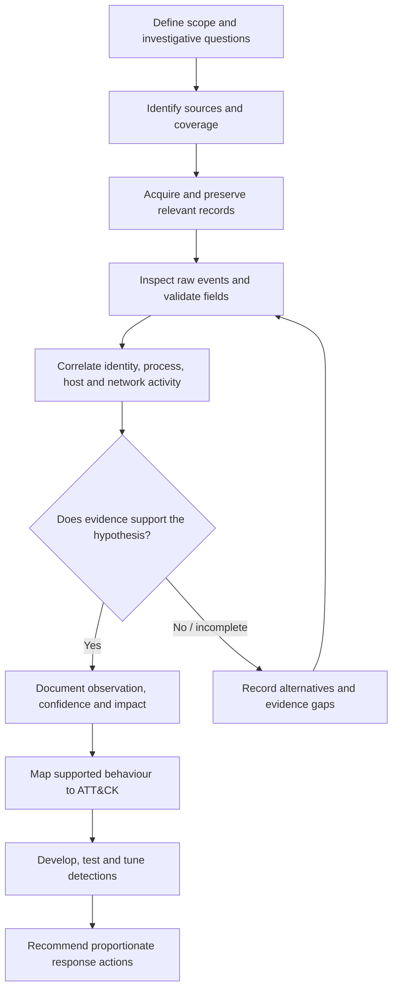

# Enterprise Intrusion Investigation
### SOC Analysis · Threat Hunting · Digital Forensics & Incident Response

  <strong>SPLUNK · WINDOWS TELEMETRY · DETECTION ENGINEERING · MITRE ATT&CK</strong>

---

## Project overview

This repository documents an evidence-led approach to enterprise intrusion investigation, threat hunting and defensive detection engineering.

It combines reusable SOC/DFIR methodology with a structured enterprise intrusion case study. The case study demonstrates how an analyst can develop hypotheses, identify relevant telemetry, correlate identity and endpoint activity, assess competing explanations, construct a timeline, evaluate impact and translate findings into detection opportunities.

**Case-study status:** the Northstar Logistics report is a reconstructed portfolio exercise. Primary event exports, reproducible Splunk result sets and original investigation screenshots are not currently retained. Its incident narrative is illustrative and must not be presented as a verified real-world investigation. The SPL examples are proposed hunt logic, not validated detections.

## Project sections

| Section | Purpose |
|---|---|
| [Case overview](01-Case-Overview/case-overview.md) | Scope, assumptions and evidence standard |
| [Investigation playbooks](02-Investigation/) | Investigative questions and analysis methods by activity area |
| [ATT&CK mapping](03-MITRE-ATTACK/attack-mapping.md) | Candidate technique mapping and confidence rules |
| [Splunk hunting](04-Detection-Engineering/splunk-hunting.md) | Reusable SPL hunt templates |
| [Detection specifications](04-Detection-Engineering/detection-rules.md) | Detection logic, tuning and validation |
| [Windows artefacts](05-Digital-Forensics/windows-artifacts.md) | Forensic value and limitations of common artefacts |
| [Incident response](06-Incident-Response/response-recommendations.md) | Containment through recovery |
| [Evidence catalogue](07-Evidence/evidence-catalogue.md) | Evidence register and handling standard |
| [Timeline](07-Evidence/intrusion-timeline.md) | Timestamp normalisation and event sequencing |
| [Enterprise intrusion case study](08-Simulated-Investigation/) | Incident assessment, findings, timeline, evidence register, detection analysis and ATT&CK mapping |

## What this project demonstrates

- Investigative question development and hypothesis testing.
- Windows Security, Sysmon, PowerShell and network telemetry analysis.
- Splunk SPL search construction and event correlation.
- Identity, process, file and network investigation.
- Evidence handling, timeline construction and confidence assessment.
- MITRE ATT&CK mapping based on supported behaviour.
- Detection design, false-positive analysis, tuning and validation.
- Incident containment, eradication, recovery and lessons learned.

## Investigation workflow

## Tools and technologies

| Technology | Investigative use |
|---|---|
| Splunk Enterprise | Search, correlation and threat hunting |
| Windows Security logs | Authentication, privileges and object access |
| Sysmon | Process, network, file and process-access telemetry |
| PowerShell logging | Script-block and module activity |
| WMI-Activity logs | WMI client and operation context |
| Firewall / proxy logs | Connection disposition and network transfer context |
| CyberChef | Safe examination of encoded or transformed data |
| MITRE ATT&CK | Behaviour classification and defensive coverage |

## Evidence and analytical standards

The repository separates:

- **Observation:** what a source record directly shows.
- **Correlation:** a relationship supported by identifiers or multiple records.
- **Assessment:** the analyst's interpretation of the observations.
- **Inference:** a plausible explanation that is not directly proven.
- **Unknown:** a question the available evidence cannot resolve.

A timestamp match alone does not establish causation. A process name alone does not establish malicious intent. LSASS access does not prove credential extraction. File creation does not prove data exfiltration. A network event does not prove command-and-control without sufficient protocol, process and session context.

No search is described as tested unless it has been executed against a known dataset and the raw results reviewed. Confirm indexes, sourcetypes, field extractions, event coverage, time range and data-model assumptions before relying on SPL.

## Current limitations and next validation work

The case study needs primary telemetry, source hashes, reproducible searches and original screenshots before it can demonstrate a completed hands-on investigation. The next technical milestone is to validate the event relationships and SPL against a permitted dataset, preserve the underlying records and update each finding only where the evidence supports it.

**Project status:** investigation methodology and a detailed reconstructed case-study report are documented. Dataset-backed validation and original evidence artefacts remain outstanding.
